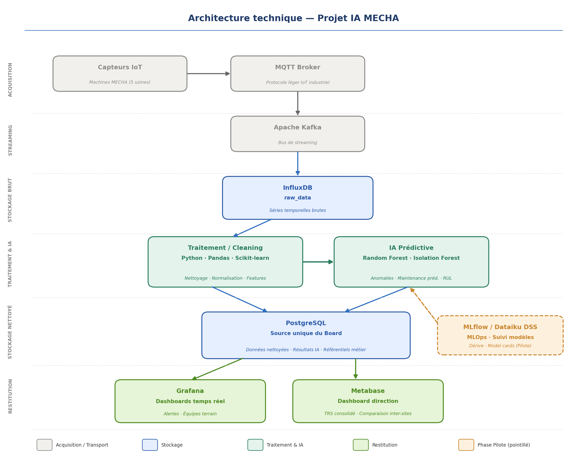

# Architecture technique et solution applicative

Choix techniques, exploitation des résultats IA par les métiers, intégration continue.

## 1. Choix techniques

### 1.1 Vue d'ensemble

Architecture en 6 couches : acquisition IoT → streaming → stockage brut → traitement/IA → stockage exploitable → restitution. Chaque brique est open-source, conteneurisable, et adaptée à un contexte industriel multi-sites.



Traits pleins : implémenté dans le prototype. Pointillés : cible, non déployée (MQTT, Kafka, MLflow).

### 1.2 Choix par couche

| Couche | Techno retenue | Justification | Alternatives écartées |
|---|---|---|---|
| Acquisition | **MQTT** | Protocole standard IoT industriel, léger, QoS configurable | HTTP (trop lourd), OPC-UA (plus adapté SCADA lourd) |
| Streaming | **Apache Kafka** | Bus scalable multi-sites, découplage producteurs/consommateurs, rétention configurable | RabbitMQ (moins scalable pour du time-series à haut débit) |
| Stockage brut | **InfluxDB** | Time-series DB optimisée pour capteurs (compression, downsampling natif) | TimescaleDB (viable, mais Influx = standard IoT) |
| Traitement | **Python + Pandas + Scikit-learn** | Écosystème ML mature, courbe d'apprentissage faible pour les équipes data | Spark (surdimensionné pour le volume MECHA) |
| Modèles ML | **Logistic Regression** (état machine) + **Random Forest** (RUL) | Retenus après comparaison de 6 classifieurs et 5 régresseurs en validation croisée (`04_modeles_et_validation.md` §1) : meilleur rappel sur la classe critique, meilleure MAE | XGBoost, Gradient Boosting, KNN, arbre seul (moins bons sur la métrique métier) ; Deep Learning (volume insuffisant, boîte noire) |
| Persistance modèle | **joblib** | Standard scikit-learn, sérialise modèle + pipeline de preprocessing | ONNX (portabilité cross-langage, non nécessaire ici) |
| Stockage exploitable | **PostgreSQL** | Source unique, mature, supporte JSON/relationnel, connecteurs universels | MongoDB (pas de contrainte relationnelle utile ici) |
| Restitution ops | **Grafana** | Standard temps réel, alertes natives, connecteur Postgres | Kibana (moins bon sur Postgres) |
| Restitution direction | **Metabase** | Self-service BI, création de dashboards sans code | PowerBI (payant, moins portable) |
| MLOps (cible) | **MLflow** | Suivi expérimentations + registry, open-source | Dataiku (payant, retenu en option) |
| Conteneurisation | **Docker + docker-compose** | Reproductibilité, portage multi-sites, requis cahier des charges | Kubernetes (prévu phase 2 industrialisation) |
| CI/CD | **GitHub Actions** | Intégré au repo Git, gratuit, YAML simple | GitLab CI (équivalent, dépend de l'hébergement du repo) |

### 1.3 Structuration du code

```
.github/workflows/ci.yml          # CI (à la racine du dépôt)
mecha-ia/
├── mecha_maintenance_predictive.ipynb   # Préparation, entraînement, évaluation, export
├── data/                # Jeux de données livrés (brut, nettoyé, prédictions)
├── src/
│   ├── cleaning.py      # Nettoyage, alerte capteur, capteur principal
│   ├── decision.py      # Règle de décision du classifieur (seuil sur P(a_risque))
│   └── api/             # Exposition des résultats (FastAPI)
├── scripts/             # Ingestion InfluxDB + pipeline d'inférence
├── tests/               # Tests unitaires (pytest)
├── docker/              # Schéma PostgreSQL
├── grafana/             # Dashboards provisionnés
└── docs/                # Documentation
```

Le code partagé entre l'entraînement (notebook) et l'inférence (pipeline) vit dans `src/` : une seule implémentation du nettoyage et de la règle de décision.

**Principes :**
- Séparation claire ingestion / traitement / modèle / restitution
- Un module = une responsabilité
- Configuration externalisée (`.env` pour les connexions, `metadata.json` pour le contrat modèle → pipeline)
- Tests unitaires sur le nettoyage, la règle de décision, l'API et le contrat d'export des modèles (les modèles eux-mêmes sont validés par métriques)

### 1.4 Gestion du code source

- **Repo Git** unique, branche `main` protégée
- Workflow : `feature/*` → PR → revue → merge sur `main`
- **CI GitHub Actions** : lint (ruff) + tests (pytest) + build des images Docker à chaque push et PR (`03_architecture_technique.md` §3)
- Jeux de données versionnés dans `data/` ; modèles régénérés par le notebook (seed fixe, résultats reproductibles)
- Cible : versioning des modèles via MLflow

### 1.5 Sécurité de l'architecture

Les exigences de **disponibilité, intégrité et confidentialité** (concept DIC) appliquées à cette architecture — healthchecks, fonctionnement dégradé, comptes applicatifs à moindre privilège, exposition réseau, secrets — sont détaillées dans `02_donnees.md` §2.4, avec l'état réel de chaque mesure et les actions prioritaires avant production.

### 1.6 Limites techniques identifiées

| Limite | Impact | Mitigation |
|---|---|---|
| Hétérogénéité des 5 usines | Formats capteurs différents | Couche d'adaptation par site à prévoir (non implémentée) |
| Volume potentiellement massif | Coût stockage Influx | Rétention 90 jours brut + downsampling |
| Dérive des modèles dans le temps | Perte de performance | Suivi MLflow + réentraînement périodique |
| Pas de labels de panne au démarrage | Blocage du supervisé | Démarrage possible en non-supervisé (Isolation Forest), non réalisé dans le prototype |

---

## 2. Solution applicative — exploitation des résultats IA

Comment les prédictions du modèle deviennent une décision de maintenance actionnable.

### 2.1 Architecture applicative

```
Pipeline IA                    Stockage                 Restitution
-----------                    --------                 -----------
run_pipeline.py                                         Grafana
  lit InfluxDB                                            dashboard Maintenance (par site)
  nettoie (src/cleaning)                                  dashboard Pilotage (multi-sites)
  charge les .joblib    -->  API REST  -->  PostgreSQL      ^
  prédit RUL + risque       (FastAPI)      predictions      | SQL lecture seule
                                           alertes          |
                                           alertes_capteur --+
```

Trois composants, trois responsabilités : le **pipeline** produit les prédictions, l'**API** les valide et applique les règles métier, **Grafana** les restitue. L'API est le seul point d'écriture ; Grafana lit la base directement en compte restreint, ce qui permet aux dashboards de rester consultables même si l'API est indisponible.

### 2.2 Mécanismes d'intégration

| Flux | Mécanisme | Détail |
|---|---|---|
| Pipeline → API | HTTP REST | `POST /predictions/{site}`, `POST /alertes-capteurs/{site}` |
| API → PostgreSQL | psycopg2 | Compte `api_rw`, schéma par site |
| Grafana → PostgreSQL | SQL direct | Compte `grafana_ro`, lecture seule |
| Notebook → Pipeline | Fichiers | `outputs/models/*.joblib` + `metadata.json` (contrat de features) |
| Consommateur tiers → API | HTTP REST | `GET /predictions/{site}`, `GET /alertes/{site}` — point d'entrée pour une intégration GMAO |

### 2.3 Paramétrage applicatif

#### 2.3.1 Règles de transformation des résultats IA

Le modèle produit un RUL et une classe de risque. L'API dérive les alertes **du RUL seul**, à l'insertion :

| Condition | Alerte générée | Délai d'action attendu |
|---|---|---|
| `rul_predit <= 4` | **critique** | Avant la fin du poste (4 h) |
| `rul_predit <= 8` | **urgent** | À planifier |
| Sinon | aucune | — |

**Pourquoi le RUL et pas la classe.** Classification et régression sont deux
modèles indépendants : ramenés aux mêmes seuils, ils se contredisent sur
21,5 % des prédictions de test (401 lignes sur 1865). Le classifieur est
volontairement réglé pour sur-détecter `a_risque` (seuil de décision abaissé à
0,35 pour tenir un rappel ≥ 80 %, cf. `04_modeles_et_validation.md` §1.6). Faire dépendre les
alertes de sa sortie produisait des alertes sur des machines dont le RUL
affiché disait « à surveiller », incompréhensible en atelier. La sortie du
classifieur reste stockée en base pour la traçabilité du modèle, mais
l'exploitation (alertes et dashboards) suit le RUL.

#### 2.3.2 Seuils

| Seuil | Valeur | Où | Origine |
|---|---|---|---|
| `normal` / `a_surveiller` | RUL = 24 cycles | `shared.niveau_depuis_rul()` (`docker/init.sql`), `SEUIL_A_SURVEILLER` (`src/api/main.py`) | Convention métier, à valider terrain |
| `a_surveiller` / `a_risque` | RUL = 8 cycles | Idem, `SEUIL_A_RISQUE` | Idem |
| Alerte critique | RUL ≤ 4 | `SEUIL_CRITIQUE` (`src/api/main.py`) | Durée d'un poste d'atelier |
| Capteur suspect | 3 valeurs aberrantes | `src/cleaning.py`, `metadata.json` | Évite de traiter un défaut instrumental comme une panne mécanique |

#### 2.3.3 Où vivent les seuils

Deux définitions, volontairement séparées et à garder alignées :

- **`shared.niveau_depuis_rul(rul)`** (`docker/init.sql`) — le niveau affiché
  dans Grafana. Les dashboards ne lisent plus la colonne `risk_level_predit`.
- **`SEUIL_CRITIQUE` / `SEUIL_A_RISQUE` / `SEUIL_A_SURVEILLER`** (`src/api/main.py`)
  — la génération d'alertes.

Le notebook entraîne le classifieur sur ces mêmes bornes (`risk_level_bins` de
`metadata.json`).

#### 2.3.4 Fréquence de mise à jour

| Élément | Fréquence |
|---|---|
| Exécution du pipeline | À la demande (`docker compose run pipeline`) ; cible : horaire planifiée |
| Rafraîchissement dashboard maintenance | 1 minute |
| Rafraîchissement dashboard pilotage | 5 minutes |
| Rechargement des dashboards provisionnés | 30 secondes |
| Réentraînement du modèle | Mensuel (cf. `04_modeles_et_validation.md` §2) |

### 2.4 Formalisme de configuration

Quatre formalismes, chacun versionné dans Git :

| Formalisme | Fichier | Rôle |
|---|---|---|
| **SQL** | Requêtes des panneaux, dans les JSON de dashboard | Règles de sélection et de tri métier |
| **YAML** | `grafana/provisioning/**` | Déclaration de la source de données et des dashboards |
| **JSON** | `outputs/models/metadata.json` | Contrat entre le notebook et le pipeline (features, seuils, validation) |
| **Variables d'environnement** | `.env` | Connexions, secrets, images déployées |

Exemple de règle métier exprimée en SQL — priorisation des interventions, panneau principal du dashboard maintenance :

```sql
SELECT machine_id, rul_predit, risk_level_predit AS niveau, capteur_principal
FROM (SELECT DISTINCT ON (machine_id) machine_id, "timestamp", rul_predit,
             shared.niveau_depuis_rul(rul_predit) AS risk_level_predit, capteur_principal
      FROM ${site}.predictions
      ORDER BY machine_id, "timestamp" DESC) d
WHERE risk_level_predit IN ('a_risque', 'a_surveiller')
ORDER BY rul_predit ASC
```

Le niveau est recalculé depuis le RUL par `shared.niveau_depuis_rul()`, et le `DISTINCT ON` ne retient que la dernière prédiction connue de chaque machine : un technicien doit voir l'état courant du parc, pas l'historique.

### 2.5 Écrans et usages par rôle

| Rôle | Écran | Usage attendu |
|---|---|---|
| Technicien maintenance | Dashboard **Maintenance prédictive** → *Machines à intervenir* | Ordre de passage de la tournée : la machine au RUL le plus faible d'abord. La colonne *Capteur à inspecter* indique où regarder en premier |
| Technicien instrumentation | → *Alertes capteur* | Distingue un défaut de mesure d'une dégradation mécanique réelle |
| Responsable maintenance | → *État du parc* et *Tendance* | Charge d'intervention à venir, dérive du parc sur 7 jours |
| Chef d'atelier / production | → *État du parc* | Anticipe les arrêts sur les lignes concernées |
| Direction industrielle | Dashboard **Pilotage industriel** | Comparaison des 5 usines, priorisation des investissements |

Le sélecteur `Site` en haut du dashboard maintenance bascule entre les 5 usines sans dupliquer les écrans.

### 2.6 Limites

- **Pas d'acquittement depuis l'interface** : les colonnes `acquittee` / `acquittee_par` existent en base, mais Grafana est en lecture seule et l'API n'expose pas encore d'acquittement. Un écran de saisie reste à construire.
- **Pas de notification sortante** : ni mail ni SMS. Les alertes se consultent dans le dashboard (`05_guide_utilisateur.md`).
- **Pas de retour terrain saisissable** : la boucle d'amélioration décrite dans `01_besoin_et_conduite_du_changement.md` §2 suppose un formulaire qui n'existe pas encore.
- **Metabase non provisionné** : le service démarre vierge, ses tableaux de bord direction sont à construire manuellement.
- **Un seul site alimenté par le pipeline** : la chaîne complète (rejeu capteurs → InfluxDB → pipeline → API → PostgreSQL → Grafana) a été vérifiée sur `site_fr1` (Grafana 13.3, PostgreSQL 16 : 50 prédictions, 30 alertes dont 6 critiques, 11 requêtes de dashboard exécutées sans erreur via la datasource `grafana_ro`). `scripts/seed_demo.sql` permet de montrer les écrans des 5 sites sans exécuter le pipeline.

---

## 3. Intégration continue (CI)

### 3.1 Pipeline (`.github/workflows/ci.yml`, à la racine du dépôt)

```
push / pull request sur main
      │
      ▼
   [test] ── lint (ruff) + tests (pytest) + validation docker-compose
      │
      ▼
   [build] ── build des images api + pipeline
              (push sur ghcr.io uniquement lors d'un push sur main)
```

Le projet vit dans le sous-dossier `mecha-ia/` : le workflow y exécute toutes
ses commandes (`defaults.run.working-directory: mecha-ia`), et le build Docker
utilise `mecha-ia/` comme contexte.

| Événement | `test` | `build` | Publication GHCR |
|---|---|---|---|
| Pull request vers `main` | Oui | Oui | Non |
| Push sur `main` | Oui | Oui | Oui |

Le build s'exécute aussi sur les pull requests : une image qui ne se construit
plus est détectée avant la fusion, pas après.

### 3.2 Images produites

| Image | Dockerfile | Tags |
|---|---|---|
| `ghcr.io/<owner>/mecha-ia-api` | `Dockerfile.api` | `latest`, `<sha du commit>` |
| `ghcr.io/<owner>/mecha-ia-pipeline` | `Dockerfile.pipeline` | `latest`, `<sha du commit>` |

Le nom du propriétaire est converti en minuscules : Docker refuse les
majuscules dans un nom d'image.

Aucun secret à configurer : `GITHUB_TOKEN` est fourni automatiquement par
GitHub Actions pour la publication sur GHCR.

### 3.3 Exécuter la solution

| | Local (dev) | Images publiées |
|---|---|---|
| Commande | `docker compose -f docker-compose.yml -f docker-compose.dev.yml up -d --build` | `docker compose up -d` avec `API_IMAGE` / `PIPELINE_IMAGE` pointant vers GHCR |
| Images api/pipeline | Construites depuis les sources | Tirées de GHCR |
